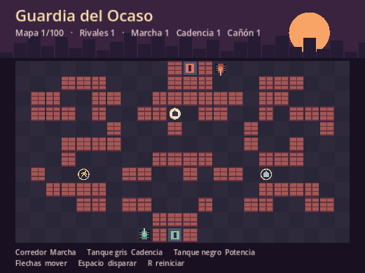
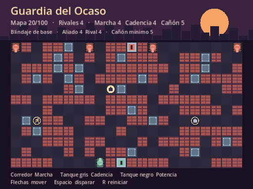
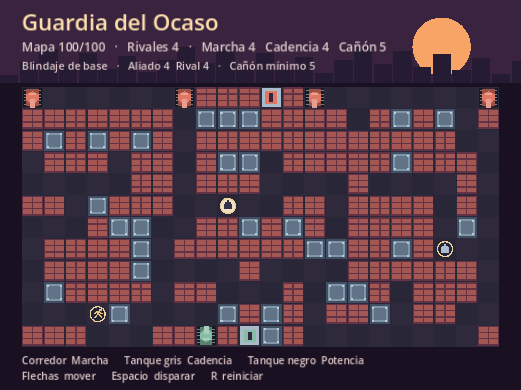

# Guardia del Ocaso

Juego de tanques en cuadrícula para un jugador. Defiende tu base en una campaña de **100 mapas**, abre paso entre los ladrillos y vence a un máximo de cuatro tanques rivales. Para ganar cada mapa puedes destruir la base enemiga o eliminar a todos sus tanques.



## Descargar e instalar

Descarga la versión para tu sistema desde [GitHub Releases](https://github.com/nediazla/guardia-del-ocaso/releases/latest).

- **Windows x86-64**. Extrae el ZIP y abre `Guardia-del-Ocaso-Windows-x86_64.exe`. El EXE contiene el juego y también está disponible por separado. Falta verificar el arranque en Windows.
- **Linux x86-64**. Ejecuta el instalador desde el directorio de descarga. Detecta la distribución, comprueba el binario y añade el juego al menú de aplicaciones. Instala en tu cuenta sin pedir permisos de administrador. Requiere glibc 2.28 o posterior. Instalación verificada en Omarchy.

  ```sh
  sh Guardia-del-Ocaso-Linux-x86_64.run
  ```

## Cómo jugar

| Control | Acción |
|---|---|
| Flechas | Mover y orientar el tanque |
| Espacio | Disparar |
| Intro | Avanzar tras ganar |
| R | Reiniciar el mapa actual |

Recoge el **corredor dorado** para acelerar, el **tanque gris** para disparar con más frecuencia y el **tanque negro** para subir el grado de tu cañón y cambiar la forma del tanque. Los cañones de mayor grado perforan acero. Los enemigos ligeros, medianos y pesados resisten de uno a cinco impactos y las bases se blindan a partir del mapa 9.

Las mejoras se conservan al ganar. Si reintentas un mapa, recuperas las mejoras con las que entraste. La campaña se juega en una sola sesión.

## Mapas avanzados

| Nivel 20 | Nivel 100 |
|---|---|
|  |  |

## Abrir el proyecto

Abre `project.godot` con Godot 4.7.2 y pulsa **F5**. Las configuraciones de exportación están en `export_presets.cfg`. Para generar los binarios, instala las [plantillas de exportación de Godot 4.7.2](https://godotengine.org/download/archive/4.7.2-stable/) y ejecuta:

```sh
mkdir -p entregas
godot --headless --export-release 'Windows x86_64'
godot --headless --export-release 'Linux x86_64'
```
